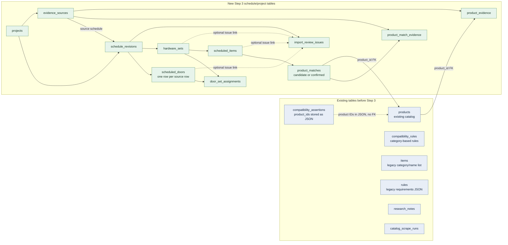

# Project and hardware schedule data model

This additive schema provides persistence for the schedule-import workflow. It is initialized in the current local SQLite database. Existing catalog products remain the source of truth; scheduled line items link to catalog products only through reviewed `product_matches` rows.

## Entity responsibilities

Blue nodes are the pre-existing tables; green nodes are the Step 3 additions. `products` stays in the existing catalog and is deliberately reused. The new `product_matches.product_id` and `product_evidence.product_id` columns are real foreign keys to it. The existing `compatibility_assertions.product_ids` value is JSON, so its product references are not enforced by a database foreign key. Existing rule, note, item, and scrape tables are not changed by Step 3.

- **Projects** group multiple schedule revisions for one construction site.
- **Evidence sources** identify schedule files and manufacturer or field documents, including URL/local path, revision, checksum, and metadata.
- **Schedule revisions** preserve each received schedule as an immutable import version; a later revision can point to the one it supersedes.
- **Scheduled doors** keep one row per source index row. `source_row_number` is the revision-local identity, so a repeated door number remains two rows until reviewed.
- **Hardware sets** are revision-local and allow repeated set codes by `occurrence_number`.
- **Door/set assignments** link doors to sets while retaining the source quantity and transcription.
- **Scheduled items** preserve heading-level quantity, units, SKU, description, page, and raw source text. `quantity_for_heading` is an aggregate from the set schedule, not an assumed per-door quantity.
- **Product matches** hold one or more catalog candidates per scheduled item. Only a human-reviewed `confirmed` match is definitive; a partial unique index prevents two confirmed catalog matches for one item.
- **Evidence links** attach specific documents and page/excerpt references to catalog products and product matches.
- **Import review issues** capture parse gaps, repeated identifiers, unresolved fields, and item-to-catalog ambiguities with an open/resolved/dismissed state.

## Scope and migration note

The schema is additive and does not change the existing catalog or compatibility verdict logic. Step 3 adds the current SQLite persistence model so local development can retain project data. The PostgreSQL migration remains a separate step; it must preserve these keys, relations, constraints, and existing catalog IDs.
