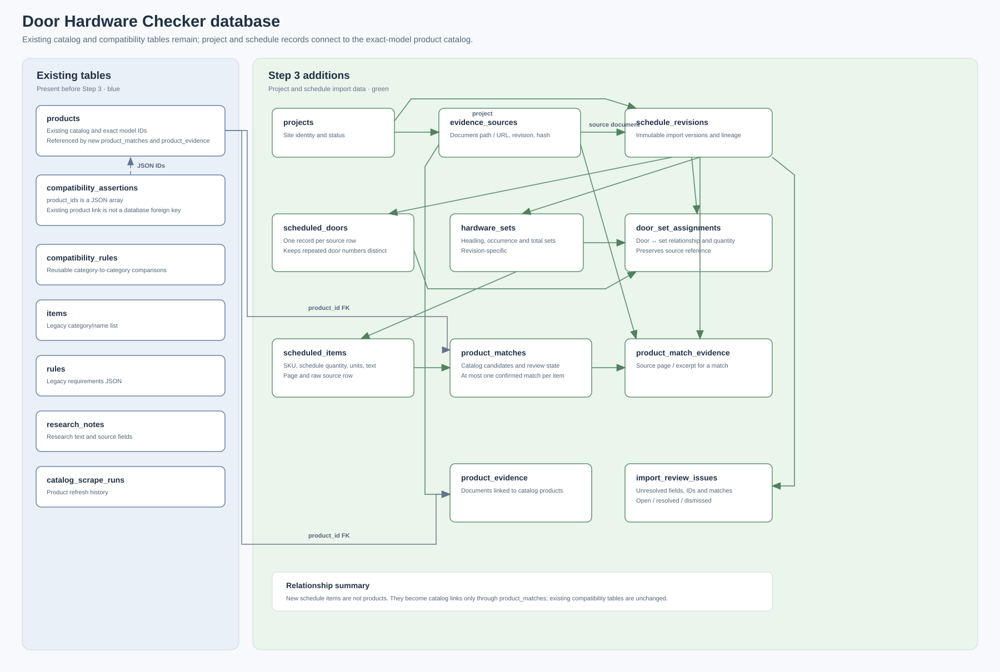

# Backend database model

Blue tables existed before the schedule-import work. Green tables were added in Step 3. The existing `products` catalog is reused by explicit product-match and evidence foreign keys.

The SQLite schedule schema is in [`SQL/sqlite_schedule_schema.sql`](../../SQL/sqlite_schedule_schema.sql). Its full table and field notes are in [`docs/project_schedule_data_model.md`](../../docs/project_schedule_data_model.md).

The schedule upload and review workflow is a later UI step. This schema only establishes where imported schedule records, catalog matches, evidence references, and review issues will be stored.

## Step 5 manufacturer research

The Belleville electrified-door sets identify Dormakaba 626QED111-MLR exit devices and 628661HD-CE-12EA electric hinges. The seeded product records preserve the schedule model text and store the manufacturer facts used in the interface comparison.

| Component | Manufacturer-backed details recorded | Source document |
| --- | --- | --- |
| Dormakaba QED111 MLR | 24 VDC ±10%; 1 A maximum inrush; 0.4 A holding current; filtered and regulated supply; conductor run limits by gauge; QED 100 sizing and door preparation | [QED 100 MLR Installation Instructions](../../public/evidence/dormakaba/QED100_MLR_Installation_Instructions.pdf) |
| Dormakaba 661HD CE-12 | Concealed electric hinge; 12-wire transfer; 83 in actual standard length for a nominal 7 ft door | [661HD CE-12 Hinge Template](../../public/evidence/dormakaba/661HD_CE12_Hinge_Template.pdf) |
| Dormakaba ED100 | 115 VAC branch power; normally-open activation inputs; 24 VDC accessory power; locking relay voltage/current limits and electric-strike delay | [ED100/ED250 SA Installation Instructions](../../public/evidence/dormakaba/ED100_ED250_SA_Installation_Instructions.pdf) |

The catalog includes a sourced pair assertion for the QED100 MLR and 661HD CE-12 hinge. It covers the hinge-to-exit-device wire-transfer interface only. It does not approve the complete door, access-control reader, power supply, fire listing, or operating sequence. The ED100 data records its interfaces and limits; it does not create an exact ED100/QED tuple approval.
